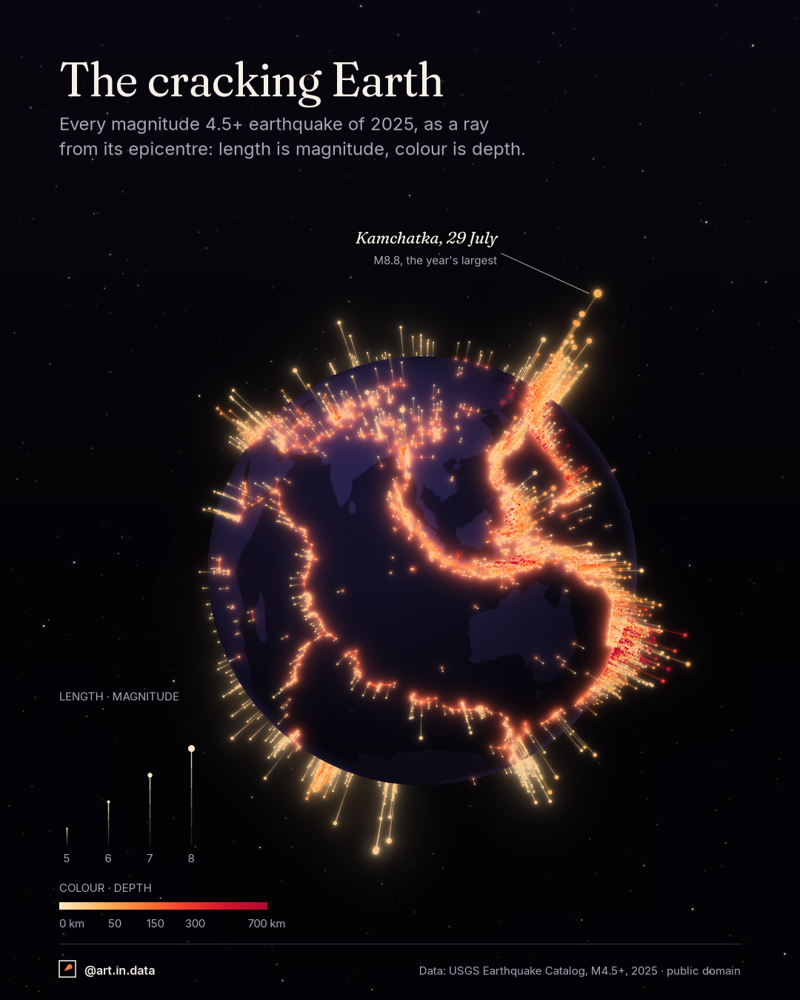

# 003 · The cracking Earth



## What it shows
Every earthquake of magnitude 4.5 or more in 2025: **8,556** of them. Each one
is a ray of light leaving the globe at its epicentre, straight out along the
surface normal. **Length is magnitude** and **colour is depth**, from pale gold
at the surface to deep red at 700 km. Rays on the far side rise past the rim,
so the whole year is visible around the orb.

The tallest ray is the **M8.8 off Kamchatka on 29 July 2025**, the largest
earthquake since Tohoku in 2011. Its aftershocks are the single most visible
feature of the year. 1,790 of the 8,556 quakes (21%) struck that one region
(lat 48-57°N, lon 155-167°E). Before July it logged about four a month. Then
702 in July, 508 in August, 295 in September, decaying to 42 by December.
1,604 of them came after the mainshock.

The globe faces 10°S, 100°E, a view picked by eye from six candidates because
the Indonesian and Kermadec arcs glow across the front and the Kamchatka ray
stands in profile on the rim. 6,727 quakes (79%) are on the side facing us.

## How to read it
- **Ray length** is linear in magnitude, from M4.4. Magnitude is logarithmic,
  so an M8.8 releases about 500 times the energy of an M7, yet its ray is
  under twice as long. The rays show magnitude, not energy.
- **Foreshortening.** A ray pointing at you looks shorter than the same ray
  seen side-on at the rim. Compare lengths near the rim. The key shows the true
  length.
- **Red cracks.** On the near side, each epicentre is joined to its (up to five)
  nearest neighbours that are less than 400 km away, by a thin glowing line
  that fades with distance. It is a proximity rule, not a claim about faults:
  the lines make belts of closely spaced quakes read as seams.

## Data
- **Source:** USGS Earthquake Hazards Program, ComCat catalog, queried through
  the FDSN event web service on 6 October 2026: events of type `earthquake`,
  magnitude 4.5+, from 2025-01-01 to 2025-12-31 UTC. Public domain
  (US Government work). Two further events in the same query are tagged
  `landslide` and were excluded.
- **Land:** Natural Earth 110m land polygons (public domain), for the faint
  continents.

## Caveats
- Magnitude 4.5 is the catalog's global completeness threshold. Smaller quakes
  are not recorded evenly around the world.
- Half the events (50%) have a depth of exactly 10 km. That is the catalog's
  default when depth cannot be resolved, so shallow colour is weak evidence.
  The deep end (286 events below 300 km, down to 670 km) is better determined.
- Magnitude types are mixed (mostly `mb`, with `mww` for the large events).
- The Kamchatka count depends on the box chosen above, and not all events in it
  are aftershocks.
- The 79% share depends on the view. Another view gives a similar share (the
  best of a 5° grid search is 81%).
- Decoration, not data: the stars, the shading of the sphere, the continents,
  and the red glow at the ray feet and along the lines.

## How it's built
- `fetch_data.py` downloads the catalog and the land polygons into `data/`.
- `quakes.py` draws both exports with `dataviz_style` (`ember` theme). Both
  platforms use the 4:5 layout (1080×1350). Only the footer's handle differs
  (the new `x_portrait` format).
  - Orthographic projection by hand. The far-side rays are drawn first and
    blurred for glow, then the opaque ball hides what is behind it, then the
    near-side rays.
  - The continents are rasterised from the polygons and mapped onto the sphere
    pixel by pixel, then drawn very faint.
  - Every glow is a blurred copy of real marks.

```
python fetch_data.py
python quakes.py
```

Code is MIT and the images are CC BY 4.0, as everywhere in the repo.
