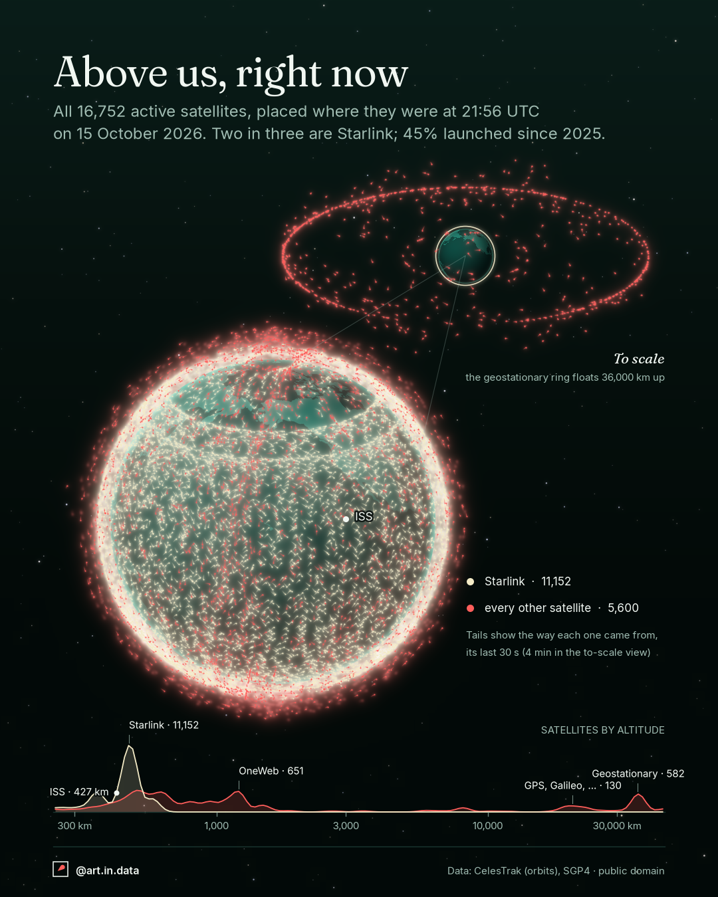

# 004 · Above us, right now



## What it shows
All **16,752** satellites CelesTrak lists as active, placed where they were at
**21:56 UTC on 15 October 2026**. Two in three (**11,152**, 67%) are Starlink,
and 45% were launched since 2025.

- **The big Earth** is wrapped in the low-orbit shell: the 15,943 satellites
  within 2,500 km of the ground. Starlink is ivory, every other satellite is
  coral red. The white dot is the International Space Station (427 km).
- **The small Earth, top right,** is drawn to scale and shows everything above
  2,500 km (809 satellites): navigation satellites at about 20,000 km and the
  geostationary ring, 582 satellites at 36,000 km. At this scale the low-orbit
  shell is thinner than a pixel, so a thin ring of light round the small Earth
  stands for it.
- **The graph at the bottom** counts satellites by altitude (log scale). Starlink
  is the tall peak at about 480 km, OneWeb sits near 1,200 km, GPS, Galileo and
  friends near 20,000 km, geostationary satellites near 35,800 km.
- **The tails** show where each satellite has just been: its last 30 seconds of
  travel on the big Earth, 4 minutes in the to-scale view. Length is speed times
  that time, so faster satellites have longer tails. Low orbit is about
  7.6 km/s, geostationary about 3.1 km/s.

## How to read it
- The two Earths are at different scales. Only the small one is to scale.
- Tails point back along the path, so the satellite is moving away from the
  tail, towards the dot. On the far side of the globe they point the opposite
  way on screen.
- The altitude graph's height is the **square root** of the count per slice, so
  that small groups stay visible next to Starlink. Compare peaks by order, not by
  area.

## Data
- **Orbits:** CelesTrak (celestrak.org, Dr T.S. Kelso), GP "active" orbital
  elements in JSON, downloaded on 15 October 2026 at 21:56 UTC. Public domain
  data derived from US Space Force tracking.
- **Launch dates:** CelesTrak SATCAT, for the "launched since 2025" share.
- **Land:** Natural Earth 110m land polygons (public domain), for the faint
  continents.

## Caveats
- It is **one instant**, and the positions are **computed, not observed**: SGP4
  propagates each satellite's elements to the snapshot minute. Elements are a few
  hours to days old, so positions are good to about a kilometre or a few, not
  exact.
- "Active" is CelesTrak's list. Starlink is identified by the name starting with
  `STARLINK`. Debris, rocket bodies and decayed objects are not drawn (SATCAT
  lists 12,543 pieces of tracked debris and 2,297 rocket bodies).
- 63 of the 809 satellites above low orbit fall outside the invisible ellipse
  of the to-scale view (highly elliptical orbits reach beyond 300,000 km) and are
  omitted there. They remain in the counts.
- The ISS is highlighted, and its dot is bigger than any other.
- The globe faces 22°N 155°W (the Pacific), chosen so that the ISS is in view
  at the snapshot moment.
- Tails are straight lines along the instantaneous velocity, relative to fixed
  space, not relative to the ground. The 4-minute tails of the to-scale view are
  an approximation, because orbits curve.
- Dots, tails and glows are drawn larger than the satellites. The glow is a
  blurred copy of the marks, not data.
- Decoration, not data: the continents, the stars, the shading and the green
  limb glow of the Earth, and the faint zoom lines between the two Earths.

## How it's built
- `fetch_data.py` downloads the elements, SATCAT and the land polygons into
  `data/`, and records the download minute in `data/snapshot.txt`. CelesTrak
  allows one `active` download per 2 hours.
- `satellites.py` draws both exports with `dataviz_style` (`orbit` theme, shared
  `globe.py` for the sphere, continents and stars). Both platforms use the 4:5
  layout (1080×1350); only the footer's handle differs.
  - SGP4 (`sgp4` package) gives each satellite's position and velocity at the
    snapshot moment.
  - A hand-made orthographic camera projects them. Far-side satellites are drawn
    first, then the opaque Earth, then the near side.
  - Each tail is a line along the screen velocity, fading away from the
    satellite, drawn into the glow layers.

```
python fetch_data.py
python satellites.py
```

Code is MIT and the images are CC BY 4.0, as everywhere in the repo.
