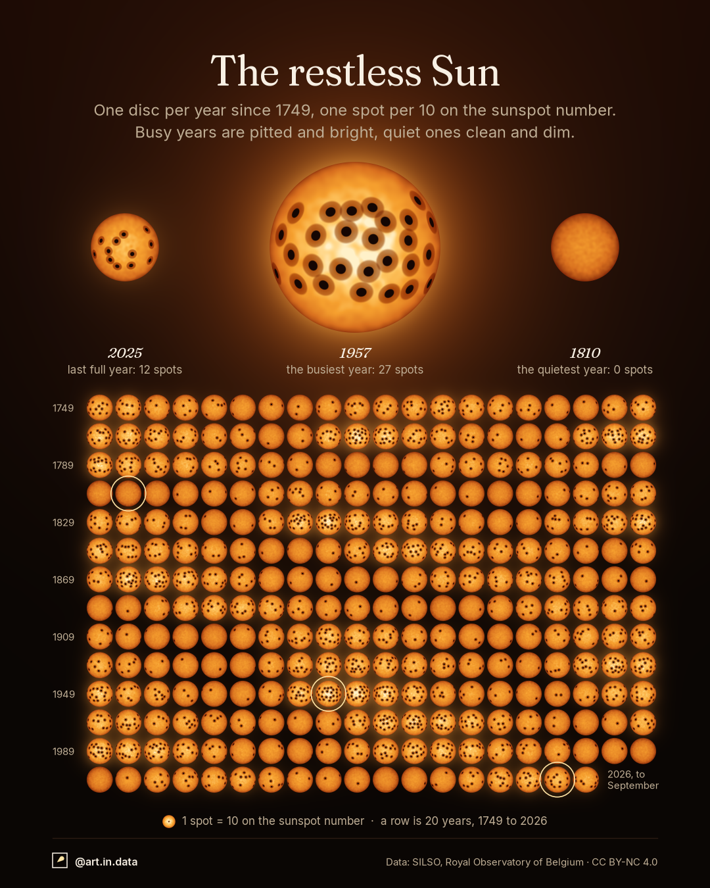

# 005 · The restless Sun



## What it shows
**278 years of sunspots**, 1749 to 2026, one disc per year. Each disc is the Sun
in that year, with **one dark spot for every 10 units of that year's mean sunspot
number**. Busy years are pitted and bright, quiet years clean and dim.

- **The three big discs** are 1957, the busiest year on record (annual mean 269,
  27 spots); 2025, the last full year (123.5, 12 spots); and 1810, the quietest
  (0.0, no spots). The same three discs are ringed in the grid.
- **The grid** is every year in calendar order, 20 per row (two decades), starting
  at 1749 in the top-left. The row labels give the first year of every second
  row. The last disc is 2026, which only covers January to September.
- **The bands** you see running through the grid are the solar cycle: activity
  rises and falls about every 11 years, but not regularly, so the bands drift.
  The long clean stretch around 1810 is the Dalton minimum, two weak cycles.
- **Brightness and halo** follow the spot count, the same number the spots show.
  A spotless disc is dim and matte, the busiest burns white-hot at the centre
  with a wide glow. They add no information; they make the difference readable.

## How to read it
- "Spot" means **10 units of the sunspot number**, not a real sunspot. The
  sunspot number is `k × (10 × groups + individual spots)`, a calibrated index
  of activity (SILSO V2.0), so a year with 27 drawn spots does not have 27
  spots on the real Sun.
- The count is the **annual mean of the monthly values**, rounded to a whole
  spot. A year below 5 has no spots: nine years do (1809, 1810, 1811, 1823,
  1901, 1913, 2008, 2009, 2019).
- All discs are the same size. The real Sun does not change size.

## Data
- **Source:** SILSO, World Data Center for the production, preservation and
  dissemination of the international sunspot number, Royal Observatory of
  Belgium, Brussels (sidc.be/SILSO). Monthly mean total sunspot number, version
  2.0 (the 2015 recalibrated series), downloaded on 20 October 2026.
- **License:** CC BY-NC 4.0 (non-commercial use only).
- **Coverage:** 3,333 monthly values, 1749-01 to 2026-09, none missing. The last
  three are provisional.

## Caveats
- Early values (before about 1850) rest on sparse, less standardised
  observations. SILSO's V2.0 series corrects the scale but not the gaps in
  observing, so the early years are less certain than the recent ones.
- **Decoration, not data:** where on the disc each spot sits (random, fixed seed
  per year, inside the Sun's real ±4° to ±34° latitude bands, so spots clump a
  little), the spot shapes and penumbrae, the granulation texture, the limb
  darkening, the glow and corona.
- 2026 is a part-year (nine months), so its disc is not strictly comparable.
- **Image license:** because the data is CC BY-NC 4.0, the images in `output/`
  are CC BY-NC 4.0 (non-commercial only), an exception to the repo's CC BY 4.0.
  See `LICENSE-images.md`.

## How it's built
- `fetch_data.py` downloads the monthly CSV into `data/`.
- `sunspots.py` draws both exports with `dataviz_style` (`solar` theme). Both
  platforms use the 4:5 layout (1080×1350); only the footer's handle differs.
  - Each disc is a small raster image: limb darkening, a faint granulation
    texture, and spots placed on a sphere and foreshortened towards the limb
    (umbra plus a warm penumbra). Spot counts are asserted exact, so no spot is
    ever silently dropped.
  - Brightness is scaled by `(spots / busiest)^0.7`, the halo by `^1.2`, so the
    glow is a blurred copy of the discs weighted by activity.

```
python fetch_data.py
python sunspots.py
```

Code is MIT. The images are CC BY-NC 4.0 (non-commercial), unlike the other posts.
