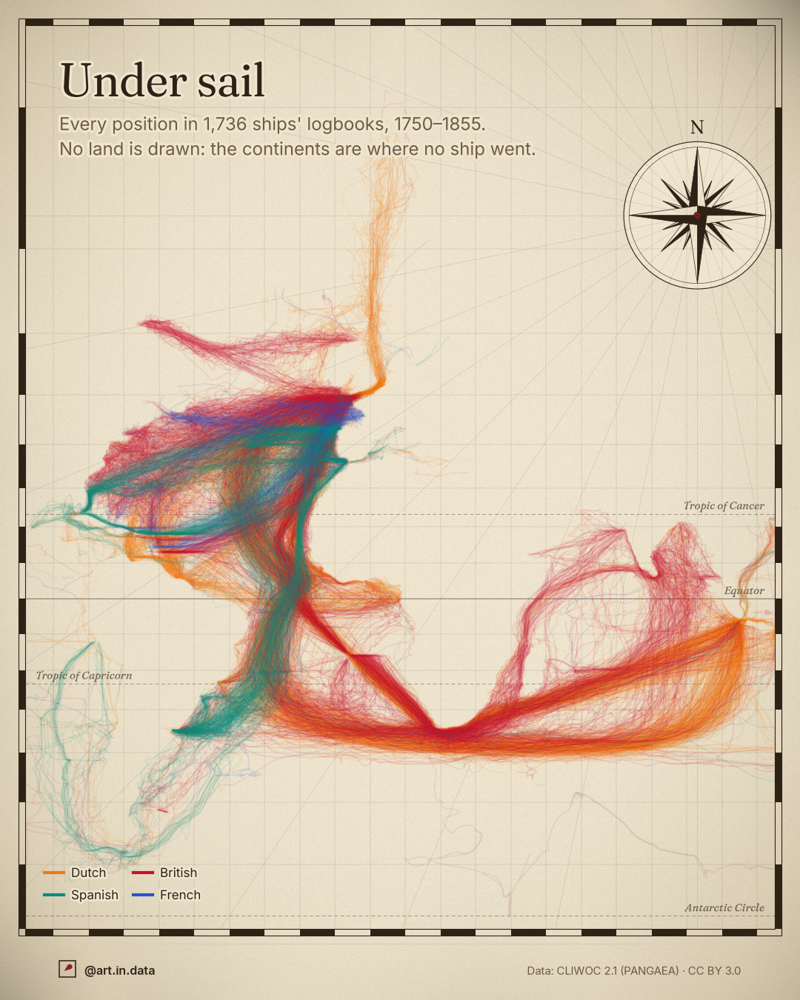

# 006 · Under sail



## What it shows
**Every position logged in 1,736 ships' logbooks, 1750 to 1855**: Dutch, British,
Spanish and French ships, about 260,000 daily positions in all. Each ship's track
is drawn as one thread from one logged position to the next, coloured by the
nation of the ship. **No land is drawn**: Africa, the Americas, Europe and India
appear only as the places no ship went.

- **The Cape of Good Hope** is the pinch point: nearly every voyage between Europe
  and Asia squeezes past it.
- **The Atlantic loop:** outbound ships to the East swing far west towards Brazil,
  riding the trade winds, before turning east for the Cape. The straight crimson
  band running north-west from the Cape is the British homeward route, by way of
  St Helena.
- **The Dutch route to Java** (orange) runs east from the Cape along the roaring
  forties, then turns north for Batavia.
- **The Spanish ships** (teal) sail between Spain and Havana, Veracruz and
  Montevideo, and round Cape Horn to the Pacific coast of South America.
- **The French logbooks** (blue) are few and almost all in the North Atlantic.

The second image is the same chart with six notes from the logbooks, each pinned
to the position the ship logged that day.

## How to read it
- It's a **Mercator chart**, the projection navigators of the time used: a
  constant compass course is a straight line on it. Shapes are true, but areas
  grow towards the poles, so Europe and the far south look bigger than they are.
- **Where threads overlap, the ink builds up.** Each track is drawn faint, so a
  bright band means many ships, and a single faint line means one.
- **Colour means nationality only.** A small number of tracks (about 1,000
  positions, from Swedish, American, Hamburg and Danish logbooks) are drawn in
  brown and are not in the key.

## Data
- **Source:** CLIWOC, Climatological Database for the World's Oceans 1750–1850,
  release 2.1 (García-Herrera et al. 2005; Koek, Können et al. 2007), archived on
  PANGAEA, [doi:10.1594/PANGAEA.611088](https://doi.org/10.1594/PANGAEA.611088).
  The GeoPackage export used is the one hosted by
  [historicalclimatology.com](https://www.historicalclimatology.com/cliwoc.html),
  downloaded on 28 October 2026.
- **License:** CC BY 3.0.
- **Coverage:** 282,322 logbook entries, of which 260,639 have a position. This
  post uses the 259,713 positions from 1750 to 1855, in 1,736 logbooks of 958
  ships: Dutch 114,507, British 91,050, Spanish 45,200, French 8,225.

## Caveats
- **What's left out:**
  - The 926 earlier positions (1662–1749) are scattered and few, so they are
    dropped to keep the dates honest.
  - The chart covers 98°W to 115°E and 68°S to about 83°N. That cuts most of
    the Pacific and the far east, and 5,076 positions (2%) fall outside it.
- **Positions are 18th-century estimates.** Latitude was measured at noon, but
  longitude was often dead reckoning before marine chronometers spread
  (c. 1800). Errors of tens of kilometres, and sometimes more, are normal.
- **Track breaks:** a thread breaks when a logbook is silent for more than 3 days
  or jumps more than 8° between two positions. Days at anchor stay in the data.
- **The logbooks are a sample, not all ships.** CLIWOC digitised what survives in
  Dutch, British, Spanish and French archives, unevenly. Dutch East India voyages
  are very well covered. Many other trades (and nations) are not.
- **Logbook notes:** the CLIWOC remarks are transcriptions, and the Dutch ones
  are sometimes short summaries in modern Dutch rather than the officers' exact
  words. I translated the Dutch quotes into English. The eclipse quote is
  English, shortened with […]. The Cook note is an annotation, not a quote: on
  17 January 1773 HMS Resolution logged sea ice at 66.6°S, the day James Cook's
  ship crossed the Antarctic Circle, the first ship known to do so.
- **Decoration, not data:**
  - The paper texture and stains are decoration.
  - The graticule, tropics and degree border are real (Mercator, every 10°).
  - The compass rose is decoration, but north really is up.
  - The 32 compass lines fanning from the rose are decoration in the style of
    old charts.
  - Each track is a smooth Catmull-Rom curve through the logged positions. Its
    width varies slightly per stroke, and it carries a sub-pixel pen tremor and
    a faint ink bleed. These are far below the precision of the positions.

## How it's built
- `fetch_data.py` downloads the 93 MB CLIWOC bundle to a temporary folder and
  keeps two small CSVs in `data/`: every position, and the free-text remarks on
  wildlife, fights and sea ice.
- `ships.py` draws both slides for both platforms with `dataviz_style`
  (`logbook` theme). Both use the 4:5 layout (1080×1350), and only the footer's
  handle differs. There's no 16:9 version: the chart is taller than it is wide,
  and a 16:9 crop would lose either Europe or the Cape.
  - The chart's longitudes are fixed. Its northern edge follows from the page
    height, so the whole page above the footer is chart.
  - Tracks are rendered into an offscreen layer, clipped to the chart, then
    composited over the paper with a blurred copy underneath for the ink bleed.

```
python fetch_data.py
python ships.py
```

Code is MIT, images are CC BY 4.0 (see the repo's `LICENSE-images.md`).
